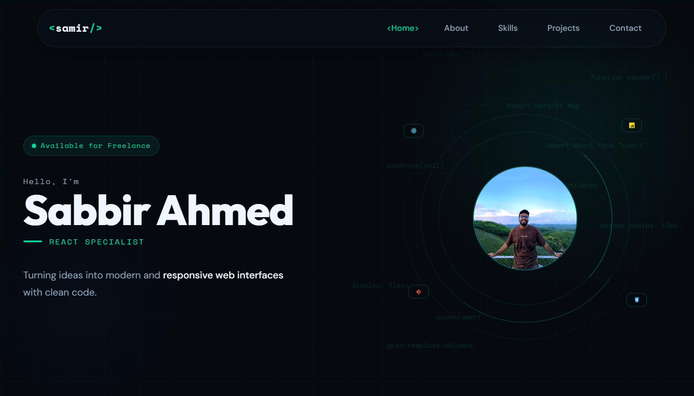

# Personal Portfolio

A responsive personal portfolio showcasing my background, technical skills, and selected projects, built with React, Vite, and Tailwind CSS.



**Live Preview:** [Sabbir Ahmed Samir](https://sabbir-ahmed-samir.vercel.app/)

## Features

- Responsive, single-page portfolio layout.
- Component-based architecture built with React.
- Fixed navigation with active-section tracking and smooth scrolling.
- Hero section with typing animation, pointer-based parallax, and reveal effects.
- About section with profile information and highlights.
- Skills section with scroll-triggered animated progress bars.
- Projects section featuring project cards, technology tags, and hover effects.
- Contact section with a direct email link and professional social links.
- Responsive footer.

## Tech Stack

- **Frontend:** React, Vite
- **Styling:** Tailwind CSS 4, custom CSS for selected visual effects
- **Language:** JavaScript (ES6+), JSX, CSS
- **UI and interactions:** React Hooks, Intersection Observer API
- **Tools:** npm, Git, GitHub

## Project Structure

```text
├── public/
├── src/
│   ├── assets/
│   │   └── images/
│   │       ├── profile-1.jpeg
│   │       └── profile-2.jpeg
│   ├── components/
│   │   ├── Navbar.jsx
│   │   ├── Hero.jsx
│   │   ├── About.jsx
│   │   ├── Skills.jsx
│   │   ├── Projects.jsx
│   │   ├── Contact.jsx
│   │   └── Footer.jsx
│   ├── styles/
│   │   └── Hero.css
│   ├── App.jsx
│   ├── index.css
│   └── main.jsx
├── index.html
├── package.json
├── vite.config.js
└── .gitignore
```

## Author

**Sabbir Ahmed Samir**

- GitHub: [@sasamir10](https://github.com/sasamir10)
- LinkedIn: [Sabbir Ahmed Samir](https://linkedin.com/in/sabbirahmed10)
